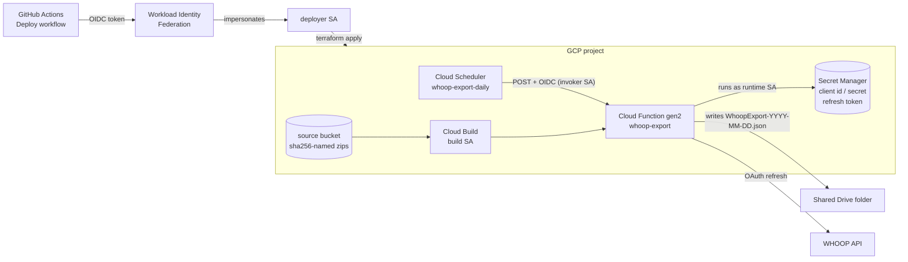

# Infrastructure (Terraform)

Everything the Cloud Function needs, as code: APIs, service accounts, Secret Manager secrets and
their IAM, the source bucket, the 2nd-gen Cloud Function, the Cloud Scheduler job, and (optionally)
keyless GitHub Actions deploys through Workload Identity Federation.



| File | What it manages |
|---|---|
| `main.tf` | Required APIs, the source-archive hash |
| `iam.tf` | `runtime`, `invoker` and `build` service accounts and their (minimal) roles |
| `secrets.tf` | Secret containers and access policy, never secret values |
| `function.tf` | Source bucket, uploaded archive, the Cloud Function |
| `scheduler.tf` | Daily Cloud Scheduler job with OIDC auth and retries |
| `github_oidc.tf` | Workload Identity pool/provider and the CI deployer (only when `github_repository` is set) |

## Design decisions

* **Secret values stay out of Terraform.** Secret Manager versions created by Terraform are
  stored in plain text in the state file, so Terraform only creates the secrets and their IAM;
  values are added with `gcloud`. A test fails if a `google_secret_manager_secret_version`
  appears.
* **Least-privilege identities.** The function no longer runs as the default compute account
  (Editor on the project). The runtime account can read its three secrets and add versions only
  to the refresh-token secret (WHOOP rotates it on every use). Scheduler signs with a separate
  account that can only invoke. Builds use their own account.
* **One instance, one request.** `max_instance_count = 1` and concurrency 1 mean two overlapping
  runs can never race to rotate the refresh token and lock the exporter out.
* **Deterministic packaging.** `python -m tools.package_function` builds the zip from the same
  `.gcloudignore` that `gcloud functions deploy` uses, with fixed timestamps and ordering. The
  object is named after the archive's SHA-256, so an unchanged tree is a no-op plan rather than a
  redeploy, and every revision maps to an exact archive.
* **Keyless CI.** GitHub Actions exchanges its OIDC token for short-lived credentials. The
  provider's `attribute_condition` rejects tokens from any other repository before IAM is
  consulted. No service-account key exists anywhere.
* **Reviewed plans are what gets applied.** The workflow saves the plan, its lock file and the
  archive as an artifact; the `apply` job applies that exact plan, behind the `production`
  environment (add required reviewers there).

Trade-off worth knowing: the deployer manages IAM in this stack, so it is privileged by nature
(`projectIamAdmin`, `serviceAccountAdmin`, …). Keep the stack in its own project so that power is
scoped to the exporter.

## First deploy (bootstrap, run once by a project owner)

```bash
PROJECT=my-health-exporter
REGION=us-central1

# 1. Remote state bucket (versioned, so state can be recovered).
gcloud storage buckets create gs://$PROJECT-tfstate --project $PROJECT --location $REGION \
  --uniform-bucket-level-access --public-access-prevention
gcloud storage buckets update gs://$PROJECT-tfstate --versioning

# 2. Package the function and configure Terraform.
python -m tools.package_function --out dist
cd infra/terraform
cp terraform.tfvars.example terraform.tfvars   # git-ignored; fill in project and folder id
terraform init -backend-config="bucket=$PROJECT-tfstate" -backend-config="prefix=health-data-pipeline"

# 3. Create the secrets first: the function mounts the client id/secret at deploy time,
#    so they need a version before the function can be created.
terraform apply -target='google_secret_manager_secret.this'
printf '%s' "$WHOOP_CLIENT_ID"     | gcloud secrets versions add whoop-client-id     --data-file=- --project $PROJECT
printf '%s' "$WHOOP_CLIENT_SECRET" | gcloud secrets versions add whoop-client-secret --data-file=- --project $PROJECT
# Run whoop.py once locally, then copy refresh_token from .whoop_token.json:
printf '%s' "$REFRESH_TOKEN"       | gcloud secrets versions add whoop-refresh-token --data-file=- --project $PROJECT

# 4. Everything else.
terraform apply
```

Then share the destination **Shared Drive** folder with the `runtime_service_account` output as
*Content manager* (a service account has no My Drive storage of its own), and trigger a run:

```bash
gcloud scheduler jobs run "$(terraform output -raw scheduler_job)" --location $REGION
```

## Deploys from GitHub Actions

Set `github_repository = "<owner>/health-data-pipeline"` in `terraform.tfvars` during the bootstrap
apply, then add these **repository variables** (they are identifiers, not secrets):

| Variable | Value |
|---|---|
| `GCP_PROJECT_ID` | your project id |
| `GCP_REGION` | optional, defaults to `us-central1` |
| `TF_STATE_BUCKET` | `$PROJECT-tfstate` |
| `GCP_WIF_PROVIDER` | `terraform output -raw github_workload_identity_provider` |
| `GCP_DEPLOY_SA` | `terraform output -raw github_deployer_service_account` |
| `GDRIVE_FOLDER_ID` | the Drive folder id |

[`.github/workflows/deploy.yml`](../../.github/workflows/deploy.yml) then plans on every pull request
that touches the function or this directory (plan shown in the run summary) and applies on merge
to `main`. Until `GCP_PROJECT_ID` is set the workflow skips itself, so forks and unconfigured
clones stay green.

## Checks

* CI runs `terraform fmt -check`, `terraform init -backend=false` and `terraform validate` on every
  push.
* `tests/test_terraform.py` parses the configuration and checks it against the Python code: the
  environment it sets satisfies `load_settings(require_drive_folder=True)`, the entry point exists in
  `main.py`, the runtime is a Python version CI tests, `days_back` validation matches the
  function's range, plus the security invariants above.
* `tests/test_package_function.py` covers `.gcloudignore` semantics, reproducibility, the
  credential-file guard, and that the real archive imports `main` with nothing else on the path.

Local equivalents:

```bash
terraform -chdir=infra/terraform fmt -check -recursive
terraform -chdir=infra/terraform init -backend=false && terraform -chdir=infra/terraform validate
pytest tests/test_terraform.py tests/test_package_function.py
```
